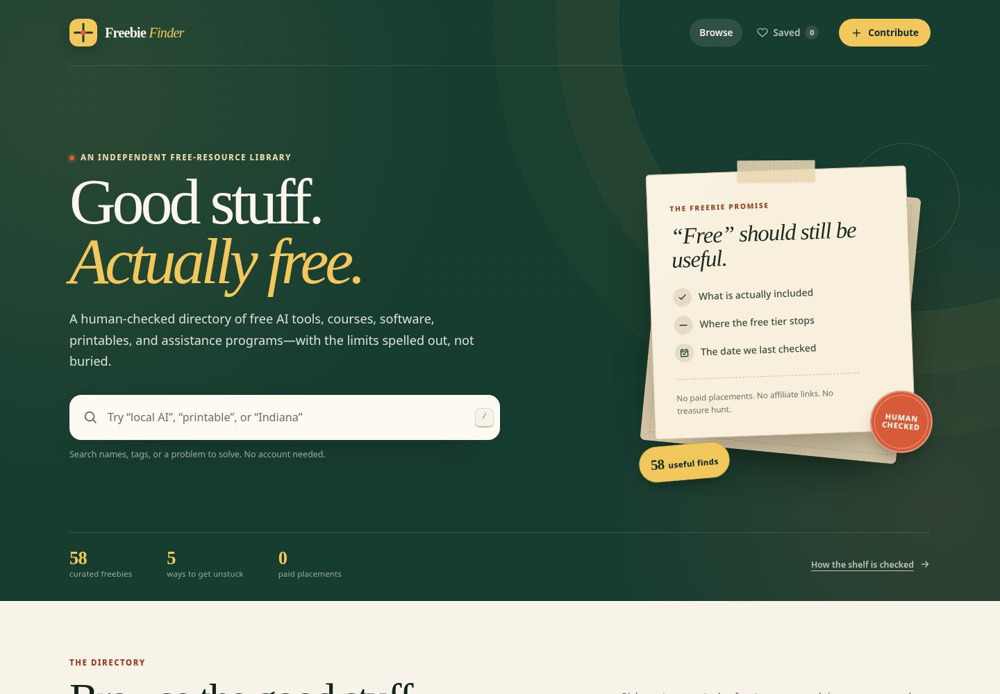

# Freebie Finder

**Good stuff. Actually free.**



Freebie Finder is a warm, searchable directory of free AI tools, courses, software, printables, and real-world assistance programs. Every listing is checked by a person, spells out what the free tier actually includes, names the catch, and shows when it was last verified.

Built and maintained by **[Asdale Dynamics, LLC](https://dylanasdale.github.io/)**. The site is static, private by default, and ready to host on GitHub Pages.

## Why this exists

The internet has no shortage of "free" lists. Too many are padded with trials, affiliate links, or tools that only become useful after an upgrade. This shelf is meant to respect your time: a smaller, useful collection with honest limits and plain-English caveats.

It is written for beginners, nurses, authors, small-business owners, and anyone trying to get something done without adding another subscription. The mix covers beginner AI and MCP education, local AI, free coding help, nursing education, publishing and reselling, bookkeeping, accessible productivity, printables, assistance programs, chess, and FFXIV planning.

## What is inside

| Category | What you will find | Listings |
| --- | --- | ---: |
| **AI tools** | Chat assistants, local models, free AI coding, learning labs, and focused helpers | 12 |
| **Courses** | Free self-paced courses, open curricula, and practical guides | 15 |
| **Software & tools** | Everyday apps for creating, selling, organizing, and a little fun | 16 |
| **Printables & templates** | Planners, labels, spreadsheets, calendars, and paper goods | 5 |
| **Programs & assistance** | Food, housing, benefits, tax, and small-business support | 10 |

The directory currently contains **58 listings** and **52 unique tags**.

Features:

- Full-text search across names, providers, descriptions, free-tier limits, caveats, regions, and tags
- Category filter plus stackable tag filters with AND matching
- Curated, recently verified, and A–Z sorting
- A browser-only Saved shelf
- Shareable filter URLs, including multiple selected tags
- Accessible keyboard support, visible focus, live result announcements, and a mobile filter panel
- No analytics, accounts, trackers, external fonts, affiliate links, or API keys
- No build step and no third-party runtime dependencies

## Quick start

Requires **Node.js 20 or newer**. There is nothing to install.

```bash
npm start
```

Open [http://127.0.0.1:4173](http://127.0.0.1:4173). To use a different port:

```bash
PORT=8080 npm start
```

To listen on another interface, set `HOST` as well:

```bash
HOST=0.0.0.0 PORT=8080 npm start
```

Use `npm start` rather than opening `index.html` directly. Browsers block the JSON request from `file://` pages.

## Verify the project

```bash
npm test
npm run check
```

- `npm test` runs 27 dependency-free tests with Node's built-in test runner. It covers the real dataset, validation rules, search and filter semantics, URL-state round trips, static-server behavior, local references, and accessibility hooks.
- `npm run check` validates `data/resources.json` on its own and prints readable errors. It rejects insecure URLs, credentials and common tracking parameters in links, duplicate IDs or URLs, invalid dates, inconsistent tag spelling, missing caveats, and category coverage gaps.

There is no compile or bundle step. The production build is the files in this folder.

## Project layout

```text
free-stuff-finder-app/
├── index.html                  # Page shell, content, dialog, and noscript fallback
├── css/styles.css              # All visual styles and responsive behavior
├── js/app.js                   # Client state, rendering, search, filters, saves
├── js/filtering.js             # Pure filtering, searching, sorting, and counts
├── js/url-state.js             # Safe, testable query-string parsing and building
├── data/resources.json         # The entire directory: categories, listings, metadata
├── scripts/serve.js            # Dependency-free local static server
├── scripts/validate-data.js    # Dataset validator used by npm run check and tests
├── tests/                      # Node test files
├── assets/                     # Favicon and README preview
├── CONTRIBUTING.md             # Editorial standards and contribution checklist
├── STATUS.md                   # Build history, verification results, known gaps
├── LICENSE
└── .nojekyll                   # Tells GitHub Pages to serve files as-is
```

## Add a listing

All content lives in [`data/resources.json`](data/resources.json). Add or update one object in the `resources` array; an ordinary listing requires no JavaScript changes.

```json
{
  "id": "example-resource",
  "name": "Example Resource",
  "provider": "Example Organization",
  "category": "courses",
  "description": "A plain-English explanation of what this helps someone do.",
  "freeTierLimits": "What is included for free, plus the meaningful limits and paid extras.",
  "tags": ["Beginners", "Coding", "Free course"],
  "url": "https://example.org/free-course",
  "region": "Global",
  "lastVerified": "2026-10-22",
  "caveat": "The honest catch, privacy note, or eligibility detail someone should know."
}
```

| Field | Rules |
| --- | --- |
| `id` | Unique lowercase slug, such as `local-ai-helper` |
| `name`, `provider` | Plain text; no marketing HTML |
| `category` | One of `ai-tools`, `courses`, `software`, `printables`, or `assistance` |
| `description` | Roughly 60–600 characters, concrete and friendly |
| `freeTierLimits` | At least 50 characters explaining what is free and where it stops |
| `tags` | At least two useful tags; reuse existing spellings where possible |
| `url` | Public HTTPS link to the official source; no affiliate or tracking parameters |
| `region` | `Global` or a precise location such as `Indiana, USA` |
| `lastVerified` | Real `YYYY-MM-DD` date; cannot be in the future or after `meta.lastReviewed` |
| `caveat` | At least 30 characters covering the catch, privacy note, or eligibility rule |

After editing:

1. Update `meta.lastReviewed` if this is a new editorial pass.
2. Run `npm run check` and `npm test`.
3. Preview with `npm start`, then search for the listing and check its card, tags, counts, and link.
4. Read [CONTRIBUTING.md](CONTRIBUTING.md) before opening a pull request.

The UI reads categories, counts, tags, stats, and dates from the JSON. The five category IDs are part of the app's information architecture; adding a new category also requires matching styles and a deliberate design review.

## Deploy to GitHub Pages

This is a no-build static site. All application links are relative, and `.nojekyll` is included.

1. Put the project at the root of a GitHub repository and push the branch you want to publish.
2. In the repository, open **Settings → Pages**.
3. Under **Build and deployment**, choose **Deploy from a branch**.
4. Select your default branch and the `/ (root)` folder, then save.
5. GitHub usually publishes within a minute or two. The site will appear at `https://<username>.github.io/<repository>/`.

No GitHub Actions, environment variables, API keys, server setup, or database are required. Filters and saves run entirely in the visitor's browser.

If the page loads but the directory does not, confirm that `data/resources.json` is in the deployed branch, that filenames retain their exact case, and that you opened the site through the Pages URL rather than the local filesystem.

## Privacy and accessibility

Favorites are stored under `freebie-finder:favorites:v1` in `localStorage`. There is no backend, no account, and no data collection by this site. Clearing site data removes saved listings. Following an external link sends you to a third-party site with its own privacy terms.

The interface includes a skip link, semantic landmarks, keyboard search (`/`), Escape behavior for search and dialogs, visible focus styles, labeled controls, accessible live result updates, a native contribution dialog, a mobile filter panel, and reduced-motion support. The final local accessibility scan reported zero axe violations; `STATUS.md` records the full verification details.

Listings are not endorsements. Free offers, eligibility, and regional availability change. Assistance information is educational and referral-oriented, not legal, medical, tax, or financial advice.

## Contributing

Corrections, better caveats, and new genuinely free resources are welcome. Start with [CONTRIBUTING.md](CONTRIBUTING.md), then run both verification commands before opening a pull request.

Please do not add affiliate or referral links, scraped marketing copy, personal data, API keys, or short-lived trials.

## License

MIT License. See [LICENSE](LICENSE).

Copyright (c) 2026 Asdale Dynamics, LLC.
